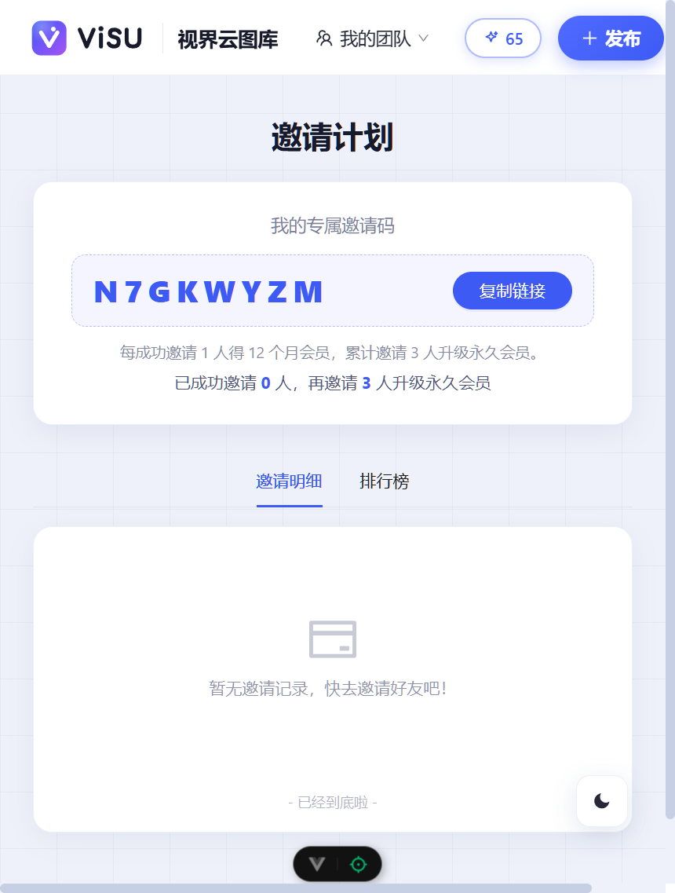
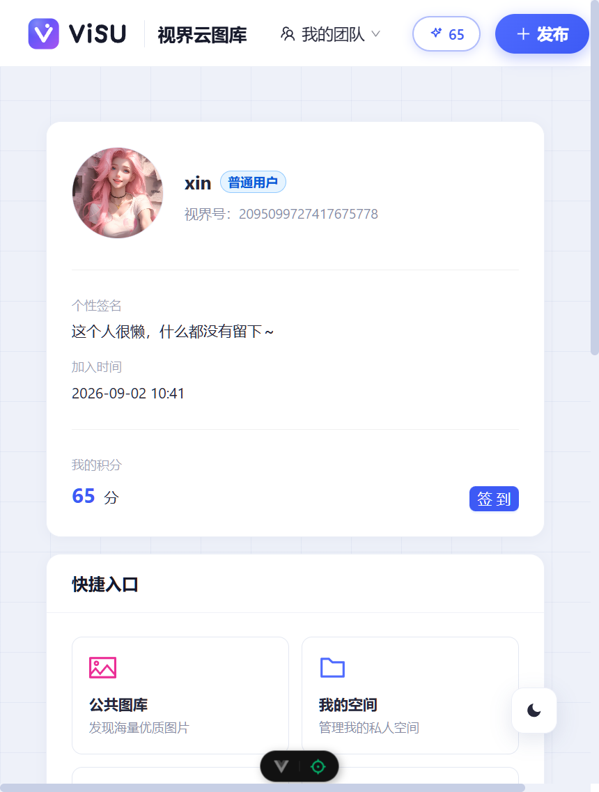
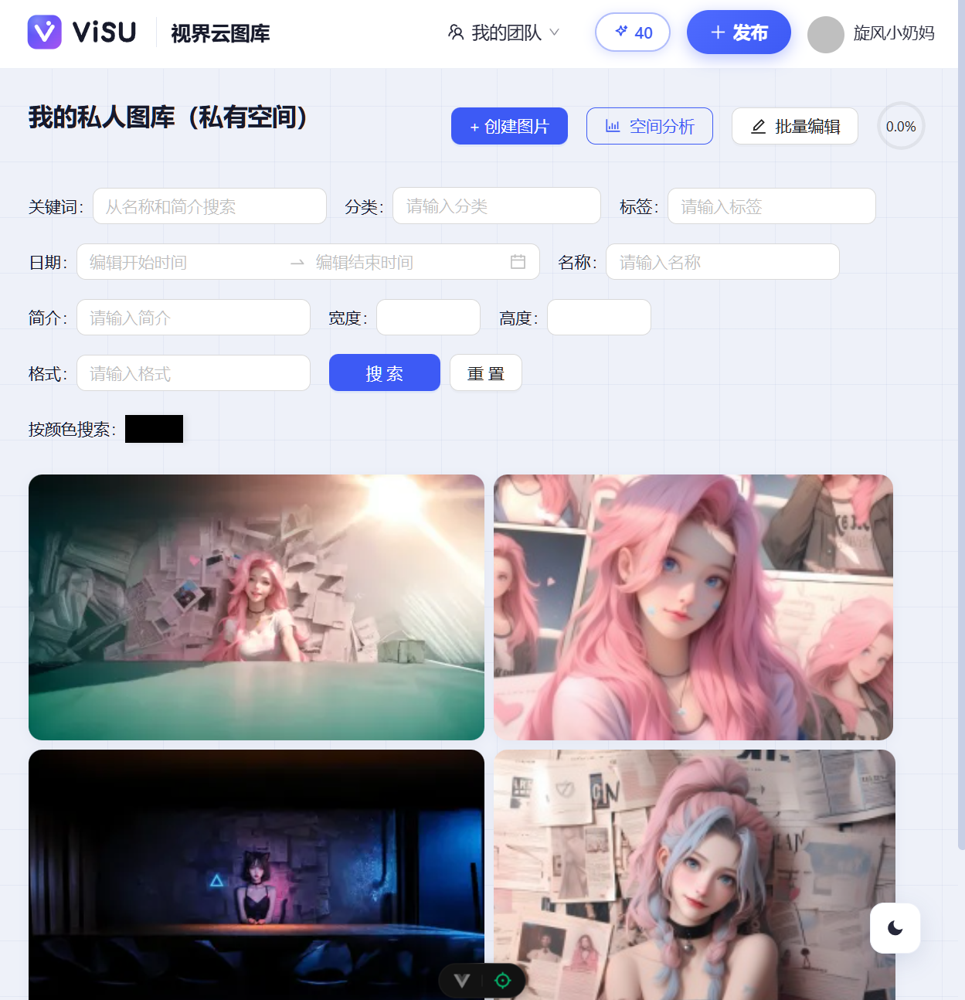
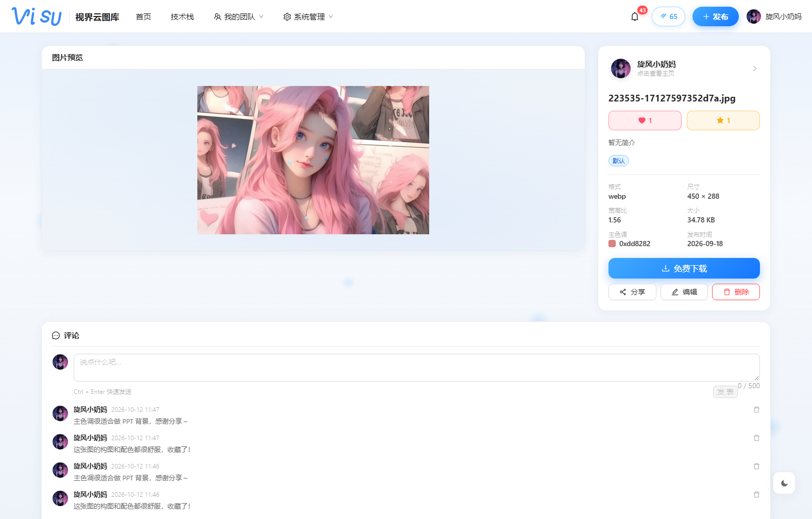
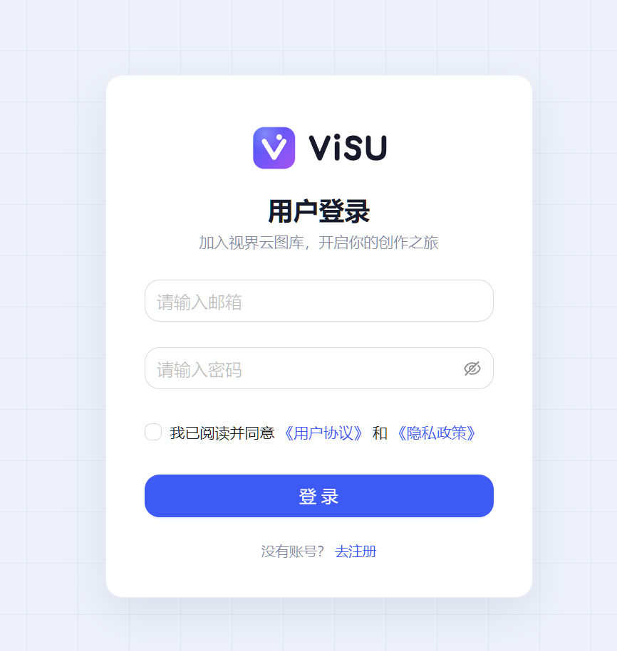
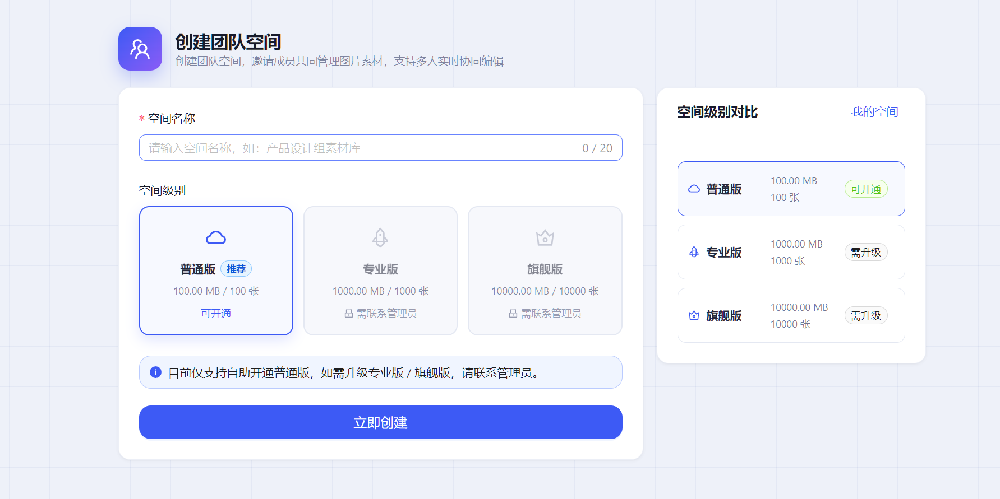
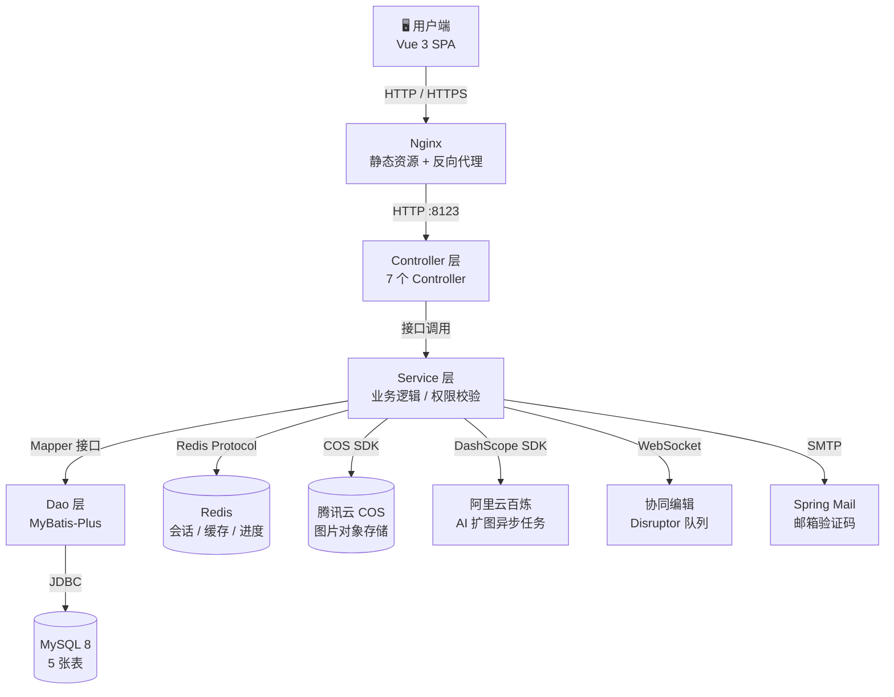
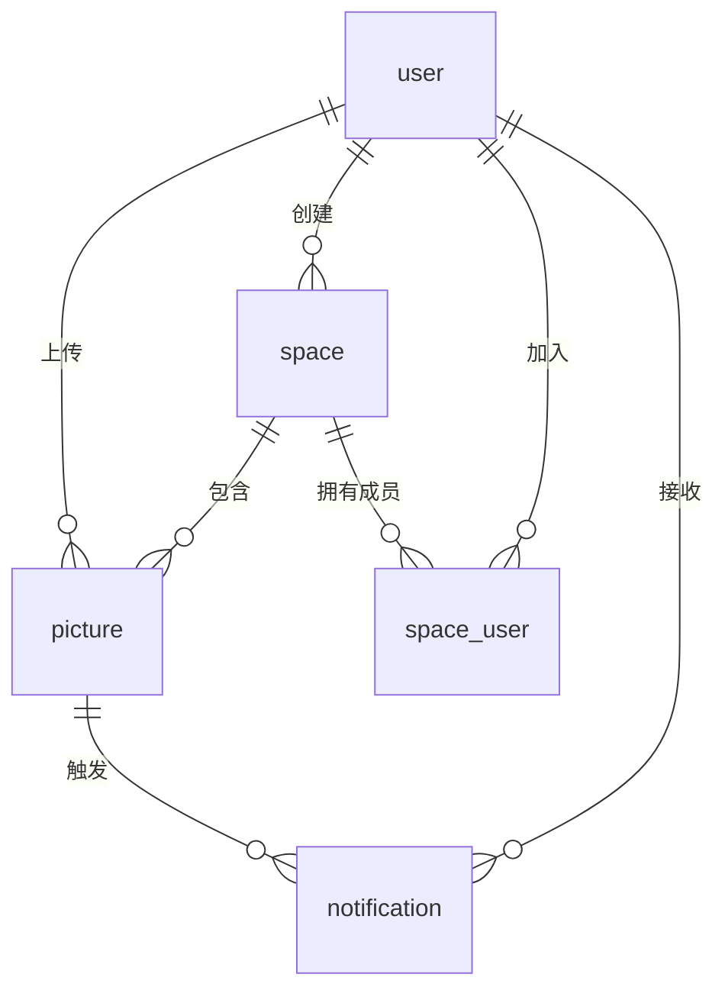

# VisU · 视界云图库 🖼️

> 一个基于 **Spring Boot 2.7 + Vue 3** 的企业级云图库协作平台：AI 扩图、团队空间协作、站内消息通知、积分签到、邀请解锁会员，一站式图片管理与创作。

<p align="center">
  
  
  
  
  
</p>

<p align="center">
  <a href="https://github.com/HeJiaxin-bot/visu-picture">GitHub</a> ·
  <a href="https://gitee.com/whirlwind-nanny/visu-picture">Gitee</a>
</p>

---

## 📸 项目预览


| 邀请计划 | 用户中心 |
|:---:|:---:|
|  |  |
| **我的空间** | **图片详情** |
|  |  |
| **登录页** | **用户协议** |
|  |  |

> 💡 访问站内 `/tech-stack` 可查看 **ECharts 力导向驱动的技术栈全景图**（含分类筛选与悬停高亮）。

---

## ✨ 功能特性

### 图片与创作
- 🖼️ **图片管理** — 上传、URL 导入、批量抓取入库、关键词搜索、以图搜图、以颜色搜图、标签分类、审核流转
- 🤖 **AI 扩图** — 接入阿里云百炼（DashScope）out-painting，异步任务轮询，结果自动打上「AI 生成」标识
- ✍️ **AI 智能配文** — 一次调用自动生成名称、简介、分类与标签
- 📦 **批量操作** — 批量抓取（必应 / Pexels 双源）、批量重命名、批量编辑分类标签、批量上传

### 团队协作
- 👥 **空间体系** — 私人空间 + 团队空间，三级空间级别（普通 / 专业 / 旗舰）
- 🔐 **RBAC 权限** — 空间成员细粒度权限（查看 / 上传 / 编辑 / 删除 / 管理），注解式鉴权切面
- ⚡ **实时协同** — WebSocket + Disruptor 无锁队列，多人同时编辑同一张图片
- 📊 **空间分析** — ECharts 可视化：使用趋势、容量占比、成员活跃排行、标签词云

### 会员与激励
- 💎 **会员体系** — `isVip` 字段与用户角色解耦，管理员兑换会员不再丢失管理权限
- 🎫 **邀请解锁** — 专属邀请码，每邀 1 人得 12 个月会员，累计 3 人升级**永久会员**，附邀请排行榜
- 🔑 **激活码兑换** — 激活码兑换会员，8 位校验 + 错误抖动 + 权益确认弹窗
- 🪙 **积分签到** — 每日签到攒积分（50 初始 / 5 每日 / 20 每次 AI 扩图）

### 消息与通知
- 🔔 **站内通知** — 导航栏铃铛 + 未读角标，悬停预览最近消息，点击直达消息中心
- 📋 **消息中心** — 四类筛选（全部 / 审核通知 / 系统通知 / 未读），服务端分页每页 10 条
- 🔄 **审核双向通知** — 用户上传图片后**通知全部管理员**待审核；管理员审核后**通知作者**结果与理由
- 📢 **管理员发布消息** — 向全员或指定用户推送站内公告，带实时预览
- 📧 **邮箱验证码** — Spring Mail 驱动，60 秒防刷倒计时

### 平台与体验
- 🌗 **主题系统** — 深色模式 + 四季配色（春樱 / 夏蓝 / 秋金 / 冬青）设计令牌
- 🔐 **合规三件套** — 用户协议/隐私政策页、注册登录协议勾选、账号自助注销
- 📱 **移动端适配** — 响应式布局 + 移动端抽屉导航 + Capacitor 打包安卓 App
- 🎨 **技术栈全景图** — ECharts 力导向关系图，5 大领域 36 项技术可视化

---

## 🛠️ 技术栈

| 层次 | 技术 |
|:---|:---|
| **前端** | Vue 3.5 · Vite 5 · TypeScript · Pinia · Vue Router 4 · Ant Design Vue 4 · ECharts 5 · Axios |
| **后端** | Spring Boot 2.7.6 · MyBatis-Plus · Sa-Token（登录鉴权 / RBAC）· AOP 注解鉴权 |
| **数据** | MySQL 8 · Redis（会话 / 缓存 / 任务进度）· ShardingSphere 分表 |
| **存储** | 腾讯云 COS（对象存储 + 缩略图 + 主色调提取） |
| **AI** | 阿里云百炼 DashScope（AI 扩图 / 智能配文） |
| **实时** | WebSocket · Disruptor 无锁队列 · Spring Session + Redis |
| **媒体** | vue-cropper 裁剪 · 瀑布流布局 · vue3-colorpicker |
| **消息** | Spring Mail（邮箱验证码）· 站内通知中心 |
| **部署** | Nginx · Docker · Capacitor（Android） |

---

## 🏗️ 系统架构



> **数据流向**：用户请求经 Nginx 转发至 Spring Boot，Sa-Token 鉴权后由 Service 处理业务——图片文件写入 COS、热点数据与会话进 Redis、业务数据落 MySQL（图片表按空间分片），AI 扩图提交百炼异步任务并轮询结果，协同编辑经 WebSocket 推送并由 Disruptor 削峰。

### 核心数据模型



| 表 | 说明 |
|:---|:---|
| `user` | 用户（含 `isVip` 会员标记、`points` 积分、`inviteCode` 邀请码） |
| `picture` | 图片（审核状态、缩略图、主色调、AI 生成标识、点赞数） |
| `space` | 空间（类型、级别、容量与数量额度、封面） |
| `space_user` | 空间成员与角色（RBAC 权限） |
| `notification` | 站内通知（审核结果 / 系统公告 / 互动） |

---

## 🚀 快速开始

### 环境要求

| 依赖 | 版本 | 说明 |
|:---|:---|:---|
| JDK | 11+ | 后端运行时 |
| Maven | 3.8+ | 后端构建 |
| Node.js | 18+ | 前端构建 |
| MySQL | 8.x | 业务数据库 |
| Redis | 6.x+ | 缓存与会话 |

### 1️⃣ 克隆项目

```bash
# Gitee（国内推荐）
git clone https://gitee.com/whirlwind-nanny/visu-picture.git

# 或 GitHub
git clone https://github.com/HeJiaxin-bot/visu-picture.git

cd visu-picture
```

### 2️⃣ 初始化数据库

```bash
# 登录 MySQL 后执行建表脚本（含全部表结构与索引）
mysql -uroot -p
source visu-picture-backend/sql/create_table.sql

# 若已有库，仅需补建通知表
source visu-picture-backend/sql/add_notification_table.sql
```

### 3️⃣ 配置后端

编辑 `visu-picture-backend/src/main/resources/application-local.yml`，填入你的真实配置：

```yaml
spring:
  datasource:
    driver-class-name: com.mysql.cj.jdbc.Driver
    url: jdbc:mysql://localhost:3306/visu?useUnicode=true&serverTimezone=Asia/Shanghai
    username: root        # 数据库用户名
    password: "你的密码"   # 数据库密码
  redis:
    database: 0
    host: localhost
    port: 6379

# 腾讯云 COS 对象存储（用于图片上传）
cos:
  client:
    host: https://你的桶名.cos.你的地域.myqcloud.com
    secretId: 你的SecretId
    secretKey: 你的SecretKey
    region: ap-shanghai
    bucket: 你的桶名

# 阿里云百炼 AI 扩图 / 智能配文
aliyun:
  ai:
    apiKey: 你的DashScopeApiKey

# 邮箱验证码（QQ 邮箱需用授权码）
spring:
  mail:
    host: smtp.qq.com
    username: 你的邮箱
    password: 你的授权码
```

> ⚠️ **安全提示**：`application-local.yml` 含真实密钥，请勿提交到公开仓库。建议改用环境变量：`${COS_SECRET_KEY}` 形式注入。

### 4️⃣ 启动后端

```bash
cd visu-picture-backend
mvn spring-boot:run
# 后端运行在 http://localhost:8123
# 接口文档 http://localhost:8123/api/doc.html
```

### 5️⃣ 启动前端

```bash
cd visu-picture-frontend
npm install
npm run dev
# 访问 http://localhost:5173
```

### 🐳 Docker 一键拉起依赖

不想本机装 MySQL / Redis？两条命令拉起：

```bash
docker run -d --name visu-mysql -p 3306:3306 \
  -e MYSQL_ROOT_PASSWORD=123456 -e MYSQL_DATABASE=visu mysql:8

docker run -d --name visu-redis -p 6379:6379 redis:6
```

---

## 📁 项目结构

```text
visu-picture
├── visu-picture-backend              # 后端服务 (Spring Boot)
│   ├── src/main/java/com/visupicture
│   │   ├── annotation                # 自定义注解（@AuthCheck 角色校验）
│   │   ├── aop                       # 鉴权切面
│   │   ├── api/aliyunai              # 阿里云百炼 AI 扩图 / 配文封装
│   │   ├── common                    # 通用响应体、分页请求
│   │   ├── config                    # 配置类（COS、Sa-Token、CORS、MyBatis-Plus）
│   │   ├── constant                  # 常量（用户角色 / 积分 / 邀请规则）
│   │   ├── controller                # 接口层（7 个 Controller）
│   │   ├── exception                 # 业务异常与全局异常处理
│   │   ├── manager                   # COS 管理器 · 分表 · WebSocket 协同 · 空间鉴权
│   │   ├── mapper                    # MyBatis-Plus Mapper
│   │   ├── model
│   │   │   ├── dto                   # 请求对象
│   │   │   ├── entity                # 数据库实体
│   │   │   ├── enums                 # 状态 / 角色 / 通知类型枚举
│   │   │   └── vo                    # 视图对象（脱敏）
│   │   ├── service                   # 业务逻辑层 + impl 实现
│   │   └── utils                     # 颜色相似度 / 颜色转换工具
│   ├── src/main/resources
│   │   ├── biz/vipCode.json          # 会员激活码
│   │   └── mapper/*.xml              # MyBatis 映射文件
│   └── sql
│       ├── create_table.sql          # 完整建表脚本
│       └── add_notification_table.sql# 通知表增量脚本
│
└── visu-picture-frontend             # 前端应用 (Vue 3 + Vite)
    └── src
        ├── api                       # OpenAPI 生成 + 手写接口客户端
        ├── assets                    # 全局样式与设计令牌（四季配色）
        ├── components                # 通用组件（图片列表 / 上传 / 裁剪 / 扩图 / 季节特效）
        ├── composables               # 组合式函数
        ├── constants                 # 前端常量
        ├── data                      # 技术栈全景图数据
        ├── layouts                   # 全局布局（顶栏 / 页脚 / 悬浮操作）
        ├── pages                     # 页面（24 个 Vue 页面）
        ├── router                    # 路由（懒加载分包）
        ├── stores                    # Pinia 全局状态（登录态 / 主题）
        └── utils                     # 工具函数（WebSocket 封装等）
```

---

## 🔌 API 接口概览

### 用户与鉴权

| 方法 | 路径 | 说明 |
|:---:|:---|:---|
| `POST` | `/api/user/register` | 邮箱 + 验证码注册，支持携带邀请码 |
| `POST` | `/api/user/login` | 账号密码登录（Spring Session + Redis） |
| `POST` | `/api/user/exchange/vip` | 激活码兑换会员 |
| `POST` | `/api/user/sign_in` | 每日签到获取积分 |
| `GET` | `/api/user/invite/info` | 我的邀请信息（邀请码 / 进度 / 会员状态） |
| `GET` | `/api/user/invite/rank` | 邀请排行榜 |

### 图片

| 方法 | 路径 | 说明 |
|:---:|:---|:---|
| `POST` | `/api/picture/upload` | 上传图片文件 |
| `POST` | `/api/picture/upload/url` | 按 URL 上传（AI 扩图结果携带 `isAiGenerated`） |
| `POST` | `/api/picture/upload/batch` | 按关键词批量抓取入库（必应 / Pexels） |
| `POST` | `/api/picture/review` | 管理员审核（通过 / 拒绝 + 理由） |
| `POST` | `/api/picture/ai_edit` | AI 智能配文 |
| `POST` | `/api/picture/out_painting/create_task` | 创建 AI 扩图异步任务 |
| `POST` | `/api/picture/search/picture` | 以图搜图 |
| `POST` | `/api/picture/search/color` | 以颜色搜图 |

### 空间与分析

| 方法 | 路径 | 说明 |
|:---:|:---|:---|
| `POST` | `/api/space/add` | 创建空间（私人 / 团队） |
| `POST` | `/api/space/list/page/vo` | 分页查询空间 |
| `GET` | `/api/space/analyze/usage` | 空间使用分析（供 ECharts 渲染） |
| `GET` | `/api/space/analyze/tag` | 标签词云数据 |

### 站内通知

| 方法 | 路径 | 说明 |
|:---:|:---|:---|
| `GET` | `/api/notification/list` | 最近通知（顶栏铃铛预览） |
| `GET` | `/api/notification/list/page` | 分页查询（`category`: all / review / system / unread） |
| `GET` | `/api/notification/unread/count` | 未读数量（角标轮询） |
| `POST` | `/api/notification/read` | 标记单条已读 |
| `POST` | `/api/notification/read/all` | 全部标记已读 |
| `POST` | `/api/notification/send` | **管理员**发布系统消息（全员 / 指定用户） |

---

## 🎯 关键设计

### 会员状态与角色解耦

早期实现中，兑换会员会直接改写 `userRole` 为 `vip`，导致**管理员兑换后丢失管理权限**。现改为独立字段：

```sql
isVip tinyint NOT NULL DEFAULT 0 COMMENT '是否会员：0-否 1-是'
```

兑换会员 / 邀请奖励只写 `vipExpireTime` 与 `isVip`，**永不改动 `userRole`**，管理员兑换后仍保留 admin 权限。所有会员判断统一走 `isVip` 字段（旧数据回退按到期时间判断）。

### 审核流程双向通知

```
用户上传 → 图片落库（reviewStatus=0 待审核）
         → 通知全部管理员「有新的图片待审核」（批量上传聚合为一条，避免刷屏）

管理员审核 → 更新 reviewStatus + reviewerId + reviewMessage
          → 通知作者「已通过」或「未通过 + 审核意见」
          → 通知发送失败仅记日志，不影响审核主流程
```

### 前端防重复提交

所有提交类操作均采用「同步置位 + 立即判断」的双重防护：

```ts
if (submitting.value) return      // 同步判断，连点直接拦截
submitting.value = true           // 在第一个 await 之前锁住
```

配合上传去重（共享 Promise，并发触发只上传一次），避免连点生成多条待审核记录。

---

## 🤝 贡献指南

1. **Fork** 本仓库，从 `master` 切出功能分支：`git checkout -b feature/your-feature`
2. 提交遵循 Conventional Commits：`feat: 新增xx` / `fix: 修复xx` / `refactor: 重构xx`
3. 推送分支并发起 **Pull Request**，描述清楚改动动机与验证方式
4. 通过审查后由维护者合并回 `master`

### 开发提示

- 前端 API 客户端由 OpenAPI 自动生成：先启动后端，再执行 `npm run openapi`
- 后端配置分环境：`application.yml`（公共）+ `application-local.yml`（本地密钥）
- 遇到 git 推送被重置，检查 hosts 是否被代理工具篡改（如 `127.0.0.1 github.com`）

---

## 📄 许可证

本项目基于 [MIT License](LICENSE) 开源，可自由使用、修改与分发。

---

<p align="center">
  <sub>Built with ❤️ using Spring Boot & Vue 3</sub>
</p>
